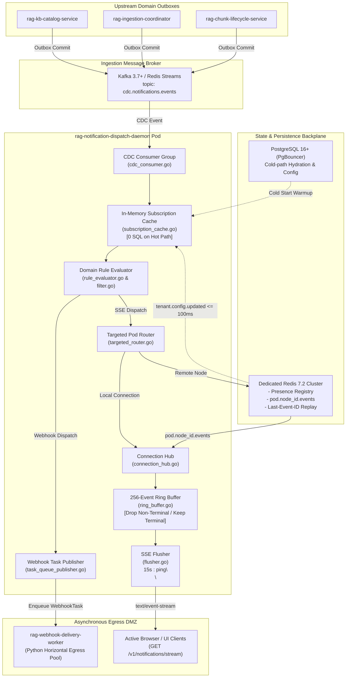
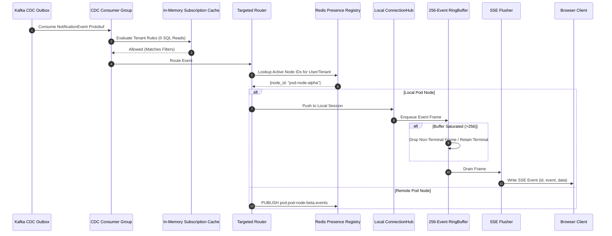
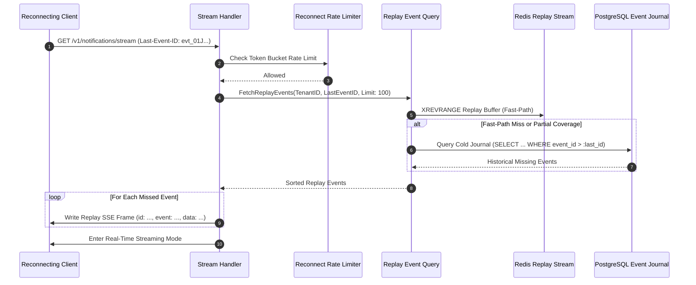

# Architecture Specification - RAG Notification Dispatch Daemon (`rag-notification-dispatch-daemon`)

[](https://golang.org)
[](file:///c:/Users/ANIK/Desktop/Gemejime/Notification%20Dispatch%20Daemon/.ai/architecture.md)
[](file:///c:/Users/ANIK/Desktop/Gemejime/Notification%20Dispatch%20Daemon/api/openapi/openapi.yaml)
[](file:///c:/Users/ANIK/Desktop/Gemejime/Notification%20Dispatch%20Daemon/internal/infrastructure/transport/hub/targeted_router.go)
[](file:///c:/Users/ANIK/Desktop/Gemejime/Notification%20Dispatch%20Daemon/.ai/code-standards.md)

---

## 1. Executive Summary & Architectural Mission

The **`rag-notification-dispatch-daemon`** is a high-density, ultra-low-latency Go 1.23+ microservice operating within the vertical feature control plane of the Multimodal RAG platform.

### Mission
The daemon ingests Change Data Capture (CDC) events emitted by upstream domain services via transactional outboxes (Apache Kafka 3.7+ or Redis 7.2 Streams), evaluates tenant-specific subscription preferences against a thread-safe in-memory cache, and dispatches notifications via two distinct channels:
1. **Multiplexed SSE Streaming (`text/event-stream; charset=utf-8`)**: Direct, unidirectional push to connected user browser sessions via persistent HTTP/2 connections with proxy-buffering bypass (`X-Accel-Buffering: no`) and 15s heartbeats.
2. **Asynchronous Webhook Enqueueing**: Packaging delivery envelopes with HMAC-SHA256 signing metadata and enqueuing them onto Redis Streams / RabbitMQ delivery queues consumed by the egress pool (`rag-webhook-delivery-worker`).

### Primary Architectural Invariants
- **Zero Hot-Path SQL Reads (ADR-004)**: Cold-path rule hydration loads from PostgreSQL 16+ via PgBouncer on startup; the hot path evaluates exclusively against local in-memory caches invalidated asynchronously via Redis Pub/Sub within $\le 100\text{ms}$.
- **Targeted Pod Routing (ADR-003)**: Eliminates $O(N \times M)$ global Pub/Sub broadcast storms by maintaining an active user/node session directory in Redis 7.2 Cluster and routing events specifically to `pod.{node_id}.events`.
- **SSRF & Egress Isolation (ADR-001)**: The daemon executes **zero** external HTTP POST requests, offloading all webhook delivery, backoff retry jitter, and egress firewalling to horizontal Python workers in the egress DMZ.
- **Bounded Memory & Drop Policies**: Per-socket 256-event ring buffers isolate client writes. Intermediate progress frames are dropped on buffer saturation, terminal states are strictly preserved, and stalled consumers ($> 5\text{s}$) are cleanly evicted.
- **Staggered Graceful Draining (ADR-005)**: Upon `SIGTERM`, `/ready` flips to `503`, new connections are rejected, and connected SSE sockets receive randomized reconnect retry jitter [30s, 60s] over a 75-second Kubernetes shutdown budget (`terminationGracePeriodSeconds: 75`).

---

## 2. End-to-End System Topology

```
[ Upstream Domain Services: rag-kb-catalog-service / rag-ingestion-coordinator / rag-chunk-lifecycle-service ]
                                            │
                                            ▼ (Transactional Outbox / CDC Stream: Kafka 3.7+ / Redis 7.2 Streams)
                             [ rag-notification-dispatch-daemon ] (Go 1.23+, GOMEMLIMIT=1800MiB, GOGC=80)
                                            │
              ┌─────────────────────────────┼─────────────────────────────┐
              ▼                             ▼                             ▼
   Local Read-Only Cache         Targeted Pod Routing          Egress Webhook Task Queue
 (In-Memory Rule Evaluator)    (Redis: pod.{node_id}.events)   (Redis Streams / RabbitMQ)
    [0 SQL Reads on Hot Path]       [Bounded 256-Event Ring]       [HMAC-SHA256 Metadata]
              │                             │                             │
              ▼                             ▼                             ▼
    PostgreSQL 16+ (Cold)       Active Client SSE Streams     [ rag-webhook-delivery-worker ]
  + tenant.config.updated      (GET /v1/notifications/stream)    (Python Egress DMZ Pool)
```



---

## 3. 5-Layer Backend Architecture

Aligned with Clean / Hexagonal Architecture principles, the daemon strictly decouples transport protocols, business rules, application orchestration, persistence adapters, and observability:

### Layer 1: API & Routing (`internal/infrastructure/transport/`, `cmd/notification-daemon/`)
- **Main Entrypoint ([`cmd/notification-daemon/main.go`](file:///c:/Users/ANIK/Desktop/Gemejime/Notification%20Dispatch%20Daemon/cmd/notification-daemon/main.go))**:
  - Configures Go 1.23+ runtime memory limit (`GOMEMLIMIT=1800MiB`) and GC percentage (`GOGC=80`).
  - Initializes PgBouncer pool, warms local subscription cache, launches Kafka CDC consumer, sets up Redis Cluster presence subscriber, and exposes HTTP server.
  - Traps `SIGTERM`/`SIGINT` for staggered graceful connection draining.
- **HTTP Routing ([`router.go`](file:///c:/Users/ANIK/Desktop/Gemejime/Notification%20Dispatch%20Daemon/internal/infrastructure/transport/http/router.go))**:
  - `/v1/notifications/stream`: Authenticated unidirectional SSE push channel with `Last-Event-ID` recovery replay.
  - `/v1/notifications/sessions`: Administrative/diagnostic telemetry endpoint returning active tenant socket sessions.
  - `/v1/notifications/subscriptions/invalidate`: Cache invalidation trigger broadcasting `tenant.config.updated`.
  - `/docs`, `/redoc`, `/api/docs`, `/openapi.json`: Live interactive OpenAPI 3.1 documentation.
  - `/healthz`: Liveness probe for process and runtime loop responsiveness.
  - `/ready`: Readiness probe verifying cache warm-up, Redis reachability, and CDC consumer status (flips to `503` during SIGTERM drain).
  - `/metrics`: Prometheus operational metrics exporter.
- **Middleware ([`middleware/`](file:///c:/Users/ANIK/Desktop/Gemejime/Notification%20Dispatch%20Daemon/internal/infrastructure/transport/http/middleware/))**:
  - Structured request logging, tenant isolation verification, JWT/channel token authentication, and token-bucket reconnect rate limiting.

### Layer 2: Persistence & Cache (`internal/infrastructure/cache/`, `internal/infrastructure/persistence/`)
- **Pod-Local In-Memory Subscription Cache ([`subscription_cache.go`](file:///c:/Users/ANIK/Desktop/Gemejime/Notification%20Dispatch%20Daemon/internal/infrastructure/cache/memory/subscription_cache.go))**:
  - Synchronized, thread-safe in-memory cache storing tenant subscription rules and notification suppressions.
  - Warmed from PostgreSQL 16+ on cold boot; invalidated asynchronously via Redis channel `tenant.config.updated` in $\le 100\text{ms}$.
- **Targeted Node Presence Directory ([`presence_registry.go`](file:///c:/Users/ANIK/Desktop/Gemejime/Notification%20Dispatch%20Daemon/internal/infrastructure/cache/redis/presence_registry.go))**:
  - Redis 7.2 Cluster registry mapping `(tenant_id, user_id)` to active `node_id` instances with short keepalive TTLs.
- **Bounded Replay Buffer & Journal ([`fetch_replay_events.go`](file:///c:/Users/ANIK/Desktop/Gemejime/Notification%20Dispatch%20Daemon/internal/application/query/fetch_replay_events.go))**:
  - Bounded Redis stream ring storing recent tenant events for fast reconnection recovery, falling back to PostgreSQL cold journal tables (`notification_event_journal`) for deep historical backfills.

### Layer 3: Application & Scale (`internal/application/`, `internal/infrastructure/transport/hub/`)
- **CQRS Orchestration**:
  - **Commands**: [`ProcessCDCEventCommand`](file:///c:/Users/ANIK/Desktop/Gemejime/Notification%20Dispatch%20Daemon/internal/application/command/process_cdc_event.go) processes ingested events and routes them; [`DispatchWebhookTaskCommand`](file:///c:/Users/ANIK/Desktop/Gemejime/Notification%20Dispatch%20Daemon/internal/application/command/dispatch_webhook_task.go) signs and enqueues external webhook payloads.
  - **Queries**: [`FetchReplayEventsQuery`](file:///c:/Users/ANIK/Desktop/Gemejime/Notification%20Dispatch%20Daemon/internal/application/query/fetch_replay_events.go) retrieves missed events after client reconnection; [`ListActiveSessionsQuery`](file:///c:/Users/ANIK/Desktop/Gemejime/Notification%20Dispatch%20Daemon/internal/application/query/list_active_sessions.go) exposes active session counts.
- **Connection Hub ([`connection_hub.go`](file:///c:/Users/ANIK/Desktop/Gemejime/Notification%20Dispatch%20Daemon/internal/infrastructure/transport/hub/connection_hub.go))**:
  - Manages active client SSE stream sessions on the local pod.
- **Per-Socket Ring Buffer ([`ring_buffer.go`](file:///c:/Users/ANIK/Desktop/Gemejime/Notification%20Dispatch%20Daemon/internal/infrastructure/transport/hub/ring_buffer.go))**:
  - Non-blocking 256-event ring buffer per stream. Drops intermediate non-terminal progress frames during saturation while preserving terminal transitions. Evicts connections stalled for $> 5\text{s}$.
- **Targeted Router ([`targeted_router.go`](file:///c:/Users/ANIK/Desktop/Gemejime/Notification%20Dispatch%20Daemon/internal/infrastructure/transport/hub/targeted_router.go))**:
  - Queries Redis presence to dispatch events directly to the specific node channel `pod.{node_id}.events`.

### Layer 4: Security, Egress & SSRF Isolation
- **Tenant Push Isolation**: Handshake tokens bind clients to a specific `tenant_id`. Cross-tenant channel subscription is strictly prevented at the domain router.
- **HMAC-SHA256 Webhook Signing**: Outbound webhook tasks contain HMAC-SHA256 cryptographic signing metadata references (`secret_ref`), preventing raw secret exposure in logs or queues.
- **Physical SSRF Isolation**: Daemon does **not** execute outbound HTTP requests. Network egress is delegated to `rag-webhook-delivery-worker` running in a restricted egress DMZ.
- **Secured Logging Invariant**: Automatic redaction of sensitive credentials (`authorization`, `token`, `secret`, `password`, `hmac_key`) in `log/slog` structured JSON output.

### Layer 5: Observability & Resilience
- **Prometheus Metrics Exporter**: Tracks connection density, CDC consumer lag, socket write latency, dropped frames, and cache invalidation latencies.
- **Distributed Tracing**: Propagates OpenTelemetry W3C `traceparent` headers across CDC outbox envelopes, Redis targeted routing, and outbound webhook delivery tasks.
- **Staggered Graceful Draining**: Spreads socket closures across a 30–60s randomized jitter window upon `SIGTERM`.

---

## 4. Architectural Decision Records (ADRs)

### ADR-001: Separation of Dispatch and Egress Delivery (SSRF Isolation)
- **Status**: Accepted & Implemented
- **Context**: Executing outbound webhook HTTP requests from the notification daemon risks Server-Side Request Forgery (SSRF), internal network scanning, DNS rebinding, and slow-client thread exhaustion.
- **Decision**: The daemon strictly manages event ingestion, SSE streaming, and webhook task enqueueing. Outbound HTTP execution is delegated to `rag-webhook-delivery-worker` in the egress DMZ.
- **Consequences**: Zero outbound HTTP execution within the daemon; $P99 \le 15\text{ms}$ enqueue latency into Redis Streams / RabbitMQ; complete isolation from external egress risks.

### ADR-002: SSE Unification for Unidirectional Push (Proxy Bypass & Low Overhead)
- **Status**: Accepted & Implemented
- **Context**: Full-duplex WebSocket connections introduce framing overhead, complex ping/pong handshakes, and sticky proxy complications. Ingestion pipeline notifications (indexing milestones, chunk status) are strictly unidirectional (server-to-client).
- **Decision**: Standardize 100% on HTTP/2 Server-Sent Events (`text/event-stream; charset=utf-8`) with explicit proxy-bypass headers (`X-Accel-Buffering: no`, `Cache-Control: no-cache`) and 15s keepalive frames (`: ping\n\n`).
- **Consequences**: Memory consumption is reduced to ~14–16KiB per idle socket (~320MiB for 20k sockets); seamless edge proxy compatibility across Cloudflare, AWS ALB, Envoy, and NGINX.

### ADR-003: Targeted Node Routing Over Global Redis Fan-Out
- **Status**: Accepted & Implemented
- **Context**: Broadcasting all CDC events to all daemon pods via global Redis Pub/Sub creates an $O(N \times M)$ message storm, saturating Redis bandwidth and causing CPU spikes under high connection density.
- **Decision**: Implement a lightweight presence registry in Redis 7.2 Cluster mapping `(tenant_id, user_id)` to active `node_id` instances. Route events exclusively to targeted node channels (`pod.{node_id}.events`).
- **Consequences**: Redis CPU utilization remains $< 30\%$ under 100,000 cluster connections; inter-pod network bandwidth drops by $> 85\%$.

### ADR-004: Pod-Local In-Memory Subscription Rule Caching
- **Status**: Accepted & Implemented
- **Context**: Querying PostgreSQL / PgBouncer for tenant notification preferences on every CDC event introduces database connection pool exhaustion and unpredictable query latency on the hot path.
- **Decision**: Cache all tenant subscription rules and notification suppressions in a thread-safe, pod-local in-memory cache. Hydrate cold cache on pod boot; invalidate asynchronously across pods via `tenant.config.updated` Pub/Sub messages within $\le 100\text{ms}$.
- **Consequences**: Zero SQL queries on the hot ingestion path; deterministic $P99 \le 50\text{ms}$ dispatch latency.

### ADR-005: Staggered Graceful Connection Draining on SIGTERM
- **Status**: Accepted & Implemented
- **Context**: When a daemon pod terminates during rolling updates, abruptly severing 20,000 active client connections causes an immediate "thundering herd" reconnection spike against remaining pods, overwhelming Redis and CPU.
- **Decision**: On `SIGTERM`, immediately flip `/ready` to `503 Service Unavailable` to divert incoming traffic. Emit an SSE `retry: <jitter_ms>\n\n` directive frame to connected clients and spread socket disconnections across a 30–60 second randomized jitter window within the 75-second Kubernetes `terminationGracePeriodSeconds`.
- **Consequences**: Reconnection traffic is smoothly distributed over time; zero thundering herd spikes; zero dropped terminal events.

---

## 5. Detailed Component Interactions & Data Flows

### 5.1 Ingestion to SSE Client Write



### 5.2 Reconnection & `Last-Event-ID` Replay



---

## 6. Runtime, Concurrency & Memory Model

### Go 1.23+ Runtime Bounds
- **`GOMEMLIMIT=1800MiB`**: Hard GC memory target enforced inside 2GiB container limits.
- **`GOGC=80`**: Aggressive GC pacing to reclaim short-lived allocation buffers before reaching memory limits.
- **Per-Socket Memory Footprint**: ~14–16KiB per idle socket (~320MiB for 20,000 idle connections).
- **Socket File Descriptors**: `ulimit -n 65535` configured in container deployment.

### Ring Buffer Drop & Eviction Policy
```
Client Saturated?
       │
       ├── No  ──► Enqueue Event Frame (Capacity: 256)
       │
       └── Yes ──► Check Event is_terminal flag
                     │
                     ├── false ──► DROP intermediate frame (increment notification_dropped_frames_total)
                     │
                     └── true  ──► RETAIN terminal state transition (evict oldest non-terminal frame)
                                   If all 256 frames are terminal, force evict socket & rely on Last-Event-ID recovery.
                                   If client write stalled > 5s, terminate connection cleanly.
```

---

## 7. Cross-Service Dependency Matrix

| Service | Protocol / Contract | Direction | Responsibility |
| :--- | :--- | :--- | :--- |
| **`rag-kb-catalog-service`** | Kafka / Redis Streams (`notification_event.proto`) | Ingress | Emits KB creation, sync milestones, and indexing triggers. |
| **`rag-ingestion-coordinator`** | Kafka / Redis Streams (`notification_event.proto`) | Ingress | Emits pipeline progress, chunking updates, and vectorization status. |
| **`rag-chunk-lifecycle-service`** | Kafka / Redis Streams (`notification_event.proto`) | Ingress | Emits chunk invalidation and re-indexing events. |
| **`rag-webhook-delivery-worker`** | Redis Streams / RabbitMQ (`webhook_task.proto`) | Egress | Consumes signed webhook tasks and executes outbound HTTP requests. |
| **Redis 7.2 Cluster** | Redis Protocol (RESP3) | Bidirectional | Presence registry, targeted pod routing channels, and replay ring buffer. |
| **PostgreSQL 16+ (PgBouncer)** | PostgreSQL Wire Protocol | Ingress (Cold) | Authoritative storage for subscription rules and historical event journals. |
| **Prometheus / Grafana** | HTTP GET `/metrics` | Egress | Scrapes operational metrics, write latency histograms, and dropped frames. |

---

## 8. Architectural Verification & Zero-Drift Gates

The architecture enforces strict automated verification gates across the development lifecycle:
1. **Contract Synchronization**: Live OpenAPI 3.1 specifications (`api/openapi/openapi.yaml`, `/docs`, `/redoc`, `/api/docs`, `/openapi.json`) and [`.ai/doc-api.md`](file:///c:/Users/ANIK/Desktop/Gemejime/Notification%20Dispatch%20Daemon/.ai/doc-api.md) are strictly validated for zero-drift.
2. **Environment & Helm Synchronization**: The Python script [`scripts/sync_env_to_deployments.py`](file:///c:/Users/ANIK/Desktop/Gemejime/Notification%20Dispatch%20Daemon/scripts/sync_env_to_deployments.py) enforces 1:1 alignment between `.env.prod` and Helm values.
3. **Performance & Soak Verification**: Continuous soak testing (`test/performance/high_density_soak_test.go`) validates memory bounds under 20,000 concurrent sockets, and chaos draining tests (`test/performance/chaos_drain_test.go`) verify jitter compliance on SIGTERM.

